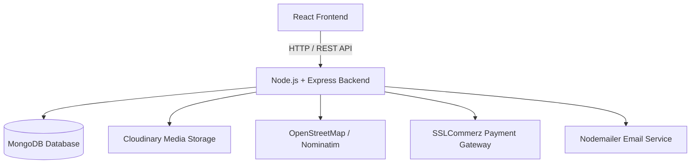

# Smart Student Mess & SpaceFit Room Allocation System

A full-stack MERN application designed to simplify student accommodation through intelligent room discovery, bed reservations, meal management, billing, and confidential maintenance operations.

**Live Demo:** [Explore the Application](https://smart-mess-management-system-qsjc-beryl.vercel.app/auth)  
**GitHub Repository:** [Smart Mess Management System](https://github.com/sadiaislam2023/smart-mess-management-system)

---

## Table of Contents

- [Overview](#overview)
- [Key Features](#key-features)
- [User Roles](#user-roles)
- [Technology Stack](#technology-stack)
- [Application Architecture](#application-architecture)
- [Getting Started](#getting-started)
- [Environment Configuration](#environment-configuration)
- [Security and Data Handling](#security-and-data-handling)
- [Collaborative Development](#collaborative-development)
- [Future Improvements](#future-improvements)
- [License](#license)

---

## Overview

Managing student accommodation involves more than assigning rooms. It requires efficient space utilization, transparent bed allocation, meal coordination, billing, and a reliable process for handling maintenance issues.

The **Smart Student Mess & SpaceFit Room Allocation System** brings these operations together in a centralized web application.

Its SpaceFit functionality helps students discover and compare accommodation options according to their preferences, budget, storage requirements, privacy needs, and other room characteristics.

The platform also supports bed reservation workflows, waitlist management, digital meal tokens, QR-based meal check-in, billing operations, food-demand analysis, and confidential complaint handling.

Developed collaboratively, the project combines modern web technologies with practical management workflows to improve accommodation administration and the student living experience.

## Key Features

### 1. SpaceFit Room Discovery and Allocation

- Building, floor, room, and bed inventory management.
- Detailed Room Space Passports featuring photographs, dimensions, layouts, amenities, rent, storage, and occupancy information.
- Preference-based room scoring and ranked recommendations.
- Visual room layouts with selectable available beds.
- Campus-distance visualization using interactive maps.
- Bed reservation requests and manager approval workflows.
- Temporary reservation holds and waitlist management.

### 2. Authentication and Role-Based Access Control

- User registration and login.
- JWT-based authentication and bcrypt password hashing.
- Role-specific dashboards and protected routes.
- Administrator approval workflows for manager accounts.
- Profile management and password changes.
- Account status management, including blocking and unblocking.

### 3. Meal Planning and Digital Check-In

- Weekly meal menu publication and management.
- Meal confirmation and cancellation within configured deadlines.
- Unique digital meal tokens.
- QR-based meal check-in and manual attendance recording.
- Meal consumption history and attendance summaries.

### 4. Billing and Payment Management

- Monthly itemized billing based on recorded meal consumption and shared expenses.
- SSLCommerz payment integration.
- Payment status tracking and digital receipt information.
- Overdue bill monitoring and reminder emails.
- Meal-demand forecasting and food-waste analysis.

### 5. Confidential Complaints and Maintenance

- Confidential resident complaint submission with optional supporting evidence.
- Separation of complaint identity information from operational complaint records.
- Token-based complaint follow-up.
- Complaint credibility screening and duplicate detection.
- Independent administrator review and complaint classification.
- Maintenance assignment, repair evidence, escalation, and resolution verification.
- Complaint and maintenance performance analytics.

*Feature availability depends on the current implementation and configuration of the application.*

## User Roles

| Role | Responsibilities |
|---|---|
| **Student / Resident** | Explore rooms, manage preferences, request beds, join waitlists, confirm meals, review consumption, manage bills, and submit confidential complaints. |
| **Mess Manager** | Manage rooms and beds, review allocation requests, publish menus, record meal attendance, monitor billing, and coordinate maintenance. |
| **System Administrator** | Approve manager accounts, manage account access, independently review complaints, oversee escalations, and monitor system analytics. |

## Technology Stack

| Category | Technologies |
|---|---|
| Frontend | React 18, JavaScript, React Router |
| UI and Styling | Bootstrap 5, Bootstrap Icons |
| Backend | Node.js, Express.js |
| Database | MongoDB, Mongoose |
| Authentication | JSON Web Tokens (JWT), bcrypt |
| File Uploads and Media | Multer, Cloudinary |
| Maps and Geolocation | Leaflet, React Leaflet, OpenStreetMap, Nominatim |
| QR Code | qrcode.react, html5-qrcode |
| Payment Integration | SSLCommerz |
| Email Notifications | Nodemailer |
| Version Control | Git, GitHub |
| Deployment | Vercel frontend and a separately deployed backend service |

## Application Architecture

The application follows a client-server architecture in which the React frontend communicates with the Express backend through REST APIs.

- **Frontend:** Provides interactive interfaces, room discovery, dashboards, and user workflows.
- **Backend:** Handles business logic, authentication, authorization, validation, and API requests.
- **Database:** MongoDB stores application data using Mongoose models and schema validation.
- **External Services:** Cloudinary supports media storage, OpenStreetMap services support mapping, SSLCommerz supports payment processing, and Nodemailer supports email notifications.

### Architecture Diagram



## Getting Started

The following instructions describe the standard process for running the application locally.

### Prerequisites

The following tools and services are required:

- [Node.js](https://nodejs.org/)
- npm, included with Node.js
- [Git](https://git-scm.com/)
- [MongoDB Community Server](https://www.mongodb.com/try/download/community) or a [MongoDB Atlas](https://www.mongodb.com/products/platform/atlas-database) database

Credentials for external services may be required for media uploads, payment processing, and email notifications.

### 1. Clone the Repository

```bash
git clone https://github.com/sadiaislam2023/smart-mess-management-system.git
cd smart-mess-management-system
```

### 2. Install Backend Dependencies

```bash
cd backend
npm install
```

### 3. Configure the Backend

Create a `.env` file in the `backend` directory.

Configure the environment variables required by the backend, including the database connection string, JWT secret, frontend origin, and credentials for any enabled external services.

The exact variable names and required settings should match the backend configuration.

### 4. Start the Backend

```bash
npm run dev
```

This command assumes that the backend's `package.json` defines a `dev` script. If the script is unavailable, use the appropriate command defined in that file.

Keep the backend terminal running.

### 5. Install Frontend Dependencies

Open a second terminal and navigate to the project root:

```bash
cd frontend
npm install
```

Configure the frontend API base URL to point to the running backend, using the environment-variable name expected by the React application.

### 6. Start the Frontend

```bash
npm start
```

For a Create React App configuration, the frontend normally starts at:

[http://localhost:3000](http://localhost:3000)

Open the local URL in a browser and verify that the frontend can communicate with the backend.

**Note:** The commands assume a repository containing `backend` and `frontend` directories. The actual directory structure, npm scripts, and environment configuration should be verified against the current source code.

## Environment Configuration

The application may require configuration for the following services:

| Configuration | Purpose |
|---|---|
| MongoDB connection string | Connects the backend to the database. |
| JWT secret | Signs and verifies authentication tokens. |
| Frontend origin | Supports appropriate cross-origin request configuration. |
| Cloudinary credentials | Enable image and media uploads. |
| SSLCommerz credentials | Enable payment gateway functionality. |
| Email service credentials | Enable email notifications. |
| Frontend API base URL | Directs frontend requests to the backend API. |

The exact environment-variable names depend on the application's configuration.

A sanitized `.env.example` file containing variable names and placeholder values can help collaborators configure their environments.

**Security reminder:** Never commit `.env` files, database credentials, JWT secrets, payment gateway secrets, or email passwords to GitHub.

## Security and Data Handling

The application incorporates security-oriented practices, including:

- Password hashing before database storage.
- JWT-protected API endpoints.
- Role-based access checks for sensitive operations.
- Manager account approval and account blocking workflows.
- Validation and conflict prevention for active bed reservations.
- Separation of complaint identity information from operational complaint records.
- Protected token-based complaint follow-up.
- Environment-based configuration for sensitive credentials.

These practices describe application-level safeguards and do not constitute a formal security audit. Production deployments should also use HTTPS, secure secret management, appropriate database access controls, input validation, and regular security testing.

## Collaborative Development

This project was collaboratively developed by:

- [**Sadia Islam**](https://github.com/sadiaislam2023)
- [**Adrija Paul**](https://github.com/adri-ja02)
- [**Maliha Nigar**](https://github.com/MALIHANIGAR)

The team collaborated on different aspects of the application, including room discovery and allocation, authentication and user management, meal planning and billing, and confidential complaint and maintenance workflows.

The project demonstrates collaborative software development across frontend interfaces, backend APIs, database modeling, application integration, and version control using Git and GitHub.

## Future Improvements

Potential areas for further development include:

- Improved mobile responsiveness and accessibility.
- More advanced room recommendation algorithms.
- Enhanced meal-demand forecasting and food-waste analysis.
- Automated integration and end-to-end testing.
- Expanded operational reporting and analytics.
- Performance optimization and additional security testing.

## License

No open-source license is specified in this repository documentation.

An appropriate license should be selected and added as a `LICENSE` file if the project is intended to be reused, modified, or distributed by others. Without an applicable license, others do not automatically receive permission to reuse or redistribute the code.

---

**Smart Student Mess & SpaceFit Room Allocation System**

*Collaborative full-stack development for smarter student accommodation management.*
